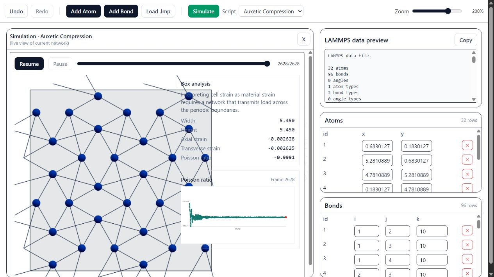

# Reproducing auxeticity in a rotating-square network

When compressed horizontally by 3%, a periodic array of corner-connected squares contracted vertically by 2.9992%. The resulting secant Poisson ratio was **−0.9997**. Grima and Evans predict **−1** for perfectly rigid squares joined at their vertices. Their Eq. 1 gives identical horizontal and vertical periods for every opening angle, so equal fractional changes are expected even across a finite compression. See Fig. 1 and Eqs. 1–6 in [Grima & Evans, *Journal of Materials Science Letters* 19, 1563–1565 (2000)](https://doi.org/10.1023/A:1006781224002).

## Reproduce in the browser

Open the [exact rotating-square network on the website](https://mendelsresearchgroup.github.io/elastic-network-editor/?example=rotating-squares) to start compression directly. To import it manually, follow these steps.

1. Save [rotating-squares.lmp](rotating-squares.lmp) and open the [Elastic Network Editor](https://mendelsresearchgroup.github.io/elastic-network-editor/).
2. Choose **Load .lmp** and select the file. Check the preview for 32 atoms, 96 bonds and 0 angles. The editor opens with a different example by default.
3. Select **Auxetic Compression**, click **Simulate**, and read **Box analysis** at the final frame. Negative axial and transverse strains mean the network narrowed in both directions.

On 19 November 2026 the public editor showed axial strain −0.002628, transverse strain −0.002625 and Poisson ratio −0.9991 at frame 2628. We paused the interactive run to capture the display. The full 3% endpoint below comes from a separate run of the same input and runtime.

## Model and measurement

The input reconstructs the geometry of Fig. 1 as a 4 × 4 periodic array. Each square has unit side length, four edge springs and two diagonal braces. Neighbors share a single corner atom and pivot freely there. From each center the four vertices lie at radius 1/√2, with the first vertex at alternating +15° and −15° to the horizontal on the two checkerboard sublattices. The center spacing is √2 cos(15°). Opposite boundaries connect through periodic bonds. Both spring types have harmonic coefficient 10 in reduced units, with rest lengths 1 and √2 respectively. These stiffnesses and the loading protocol are choices for this reconstruction.

The editor uses lammps.js 1.6.2 to run the periodic network in a browser worker. Its [compression script](../../public/auxetic/compress.deformation) minimizes the cell, records the reference dimensions, then shortens the horizontal period at a strain rate of 10⁻⁵ for 300,000 steps of 0.01. It targets zero transverse pressure so the height can respond freely. The Langevin temperature target is 10⁻⁷ in reduced units and the seed is 904297.

| Cell dimension | After minimization | After compression | Engineering strain |
| --- | ---: | ---: | ---: |
| Width | 5.46410162 | 5.30017853 | −3.000001% |
| Height | 5.46410162 | 5.30022240 | −2.999198% |

The table comes from the [reproduction script](reproduce.mjs), which uses the editor's parser, exporter, unmodified input scripts and box measurement function. The ratio is −(transverse strain)/(axial strain). Its absolute difference from the ideal value is 0.00027. This single loading direction tests the geometric prediction with finite-stiffness squares and freely moving hinges. Establishing isotropy, stiffness or rate dependence would require additional runs.

To repeat the numerical measurement from the editor repository root, use Node 24, run `npm ci`, then `node examples/rotating-squares/reproduce.mjs`. The script prints the reference cell, final cell and derived strains as JSON. The editor and simulation scripts used for this study are pinned at [831af20](https://github.com/MendelsResearchGroup/elastic-network-editor/tree/831af201fb4b0e5d8b55bbc75174d144aacfd0a6).
